# Filament Kanban

[](composer.json)
[](https://filamentphp.com)
[](https://livewire.laravel.com)
[](LICENSE.md)

Build Kanban boards with native Filament filters, forms, actions, and infolists. Move Eloquent records between columns, choose a card layout, and load cards progressively or paginate each column using a fluent PHP API.

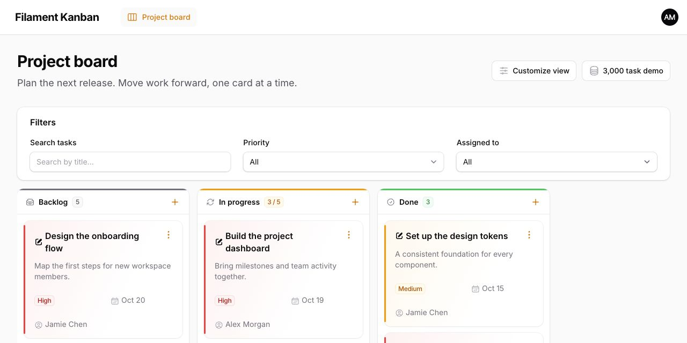

All screenshots use the standard Filament theme and fictional project data. The [standalone demo](docs/demo/README.md) includes the source and seed data used to capture them.

## Features

- **Native Filament components** — Use table filters, infolist entries, action modals, confirmations, and authorization.
- **Drag and drop** — Move cards between columns and persist their order. Drag the whole card or enable a dedicated handle.
- **Four card layouts** — Default, Compact, Flat, and Accent, with custom views and colors per record.
- **Card and column actions** — Add individual actions or `ActionGroup` menus. Compact card actions into a header menu with one boolean option.
- **Shared action forms** — Define a form once for create, edit, and view actions, including actions inside groups.
- **Progressive loading or pagination** — Load more cards as each column scrolls, or use independent pages, while keeping complete filtered counts and totals.
- **Custom empty states** — Configure headings, descriptions, icons, actions, or a custom view.
- **Compiled package styles** — Package CSS and Tailwind utilities ship in `dist`; an application frontend build is not required for the package styles.

## Table of Contents

- [Installation](#installation)
- [Quick Start](#quick-start)
- [Columns](#columns)
- [Cards](#cards)
- [Actions and Forms](#actions-and-forms)
- [Filters](#filters)
- [Drag and Drop](#drag-and-drop)
- [Empty States](#empty-states)
- [Large Boards and Pagination](#large-boards-and-pagination)
- [Customization](#customization)
- [API Reference](#api-reference)
- [Demo and Screenshots](#demo-and-screenshots)
- [Testing](#testing)
- [License](#license)

## Installation

Requires **PHP 8.4+**, **Filament 5**, and **Livewire 4.1+** in a Laravel application with a configured Filament panel.

```bash
composer require eduardoribeirodev/filament-kanban
php artisan filament:assets
```

Laravel discovers the service provider automatically. No panel plugin registration is needed.

The package registers its compiled stylesheet through Filament's asset system. You do not need to add the package to your application's Tailwind sources or run your application's Vite build for the package styles. Your own custom views may still require compiling any additional utilities they introduce.

After updating the package, republish the Filament assets:

```bash
php artisan filament:assets
```

## Quick Start

### 1. Prepare your model

The examples use a `Task` model with a status and an integer position. Match column IDs to the values stored in the status attribute.

```php
use Illuminate\Database\Schema\Blueprint;
use Illuminate\Support\Facades\Schema;

Schema::create('tasks', function (Blueprint $table): void {
    $table->id();
    $table->string('title');
    $table->text('description')->nullable();
    $table->string('status')->default('backlog');
    $table->string('priority')->default('medium');
    $table->unsignedInteger('position')->default(0);
    $table->timestamps();

    $table->index(['status', 'position', 'id']);
});
```

```php
namespace App\Models;

use Illuminate\Database\Eloquent\Model;

class Task extends Model
{
    protected $fillable = [
        'title', 'description', 'status', 'priority', 'position',
    ];
}
```

### 2. Create a board page

Create `app/Filament/Pages/Tasks.php` and extend the package's `BoardPage`:

```php
namespace App\Filament\Pages;

use App\Models\Task;
use EduardoRibeiroDev\FilamentKanban\Board;
use EduardoRibeiroDev\FilamentKanban\BoardColumn;
use EduardoRibeiroDev\FilamentKanban\Enums\CardView;
use EduardoRibeiroDev\FilamentKanban\Pages\BoardPage;
use Filament\Actions\CreateAction;
use Filament\Actions\DeleteAction;
use Filament\Actions\EditAction;
use Filament\Forms\Components\Select;
use Filament\Forms\Components\Textarea;
use Filament\Forms\Components\TextInput;
use Filament\Infolists\Components\TextEntry;
use Filament\Tables\Filters\SelectFilter;

class Tasks extends BoardPage
{
    public function board(Board $board): Board
    {
        return $board
            ->query(fn () => Task::query())
            ->statusColumn('status')
            ->positionColumn('position')
            ->recordTitleAttribute('title')
            ->columns([
                BoardColumn::make('backlog')->label('Backlog')->color('gray'),
                BoardColumn::make('in_progress')->label('In progress')->color('warning'),
                BoardColumn::make('done')->label('Done')->color('success'),
            ])
            ->cardView(CardView::Accent)
            ->cardSchema([
                TextEntry::make('description')->hiddenLabel(),
                TextEntry::make('priority')->badge(),
            ])
            ->form([
                TextInput::make('title')->required(),
                Textarea::make('description'),
                Select::make('priority')
                    ->options(['low' => 'Low', 'medium' => 'Medium', 'high' => 'High'])
                    ->default('medium')
                    ->required(),
            ])
            ->cardActions([
                EditAction::make(),
                DeleteAction::make(),
            ])
            ->cardAction('edit')
            ->compactCardActions()
            ->columnActions([
                CreateAction::make()
                    ->model(Task::class)
                    ->icon('heroicon-o-plus')
                    ->iconButton()
                    ->mutateDataUsing(function (array $data, array $arguments): array {
                        $data['status'] = $arguments['column'];
                        $data['position'] = ((int) Task::where('status', $data['status'])->max('position')) + 1;

                        return $data;
                    }),
            ])
            ->filters([
                SelectFilter::make('priority')
                    ->options(['low' => 'Low', 'medium' => 'Medium', 'high' => 'High']),
            ])
            ->deferFilters(false)
            ->cardsPerPage(25);
    }
}
```

The page is discovered by a panel configured with `discoverPages()`. Otherwise, register it in your panel provider:

```php
$panel->pages([\App\Filament\Pages\Tasks::class]);
```

For a page attached to a Filament resource, extend `EduardoRibeiroDev\FilamentKanban\Resources\Pages\BoardPage` and register it in that resource's `getPages()` method. Both page classes provide the same `board(Board $board): Board` API.

Keep tenant and access scopes in `query()`. Use that same scope when calculating positions or creating related records.

## Columns

Column IDs can be strings or integers. They must match the model attribute configured with `statusColumn()`:

```php
BoardColumn::make('in_progress')
    ->label('In progress')
    ->color('warning')
    ->icon('heroicon-o-arrow-path')
    ->limit(5);
```

Colors accept Filament color names, hexadecimal strings, or Filament color palettes. If no label is provided, the package generates one from the ID.

`limit()` is a visual work-in-progress indicator. The count badge changes when the filtered total exceeds the limit; it does not reject a move or a new record.

You can build columns dynamically:

```php
$board
    ->statusColumn('stage_id')
    ->columns(fn () => Stage::query()
        ->orderBy('position')
        ->get()
        ->map(fn (Stage $stage) => BoardColumn::make($stage->id)
            ->label($stage->name)
            ->color($stage->color ?? 'gray'))
        ->all());
```

## Cards

### Card content

Use native infolist entries and schema layout components inside `cardSchema()`. Each card receives its own Eloquent record:

```php
use Filament\Infolists\Components\TextEntry;
use Filament\Schemas\Components\Grid;

$board->cardSchema([
    TextEntry::make('description')->hiddenLabel()->color('gray'),
    Grid::make(2)->schema([
        TextEntry::make('priority')->badge(),
        TextEntry::make('due_date')->date('M j'),
    ]),
    TextEntry::make('assignee')->icon('heroicon-o-user-circle'),
]);
```

`recordTitleAttribute('title')` adds a separate title. With `cardAction('edit')`, clicking that title opens the registered `edit` action, including one nested inside an `ActionGroup`.

### Card layouts

```php
use EduardoRibeiroDev\FilamentKanban\Enums\CardView;

$board->cardView(CardView::Flat);
```

| Layout | Appearance |
| --- | --- |
| `CardView::Default` | Standard spacing, title, and schema content. |
| `CardView::Compact` | Smaller padding and tighter spacing. |
| `CardView::Flat` | Transparent rows with subtle dividers and hover feedback, without individual card borders or shadows. |
| `CardView::Accent` | A colored side stripe and a softly tinted background. |

The screenshots below show the same tasks across three columns, using the same framing for every layout.

#### Default

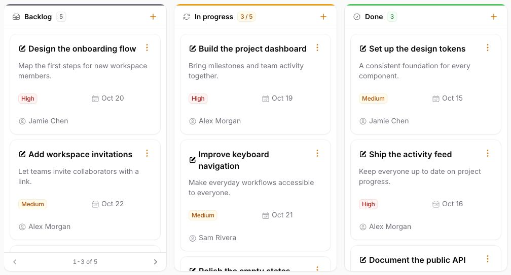

#### Compact

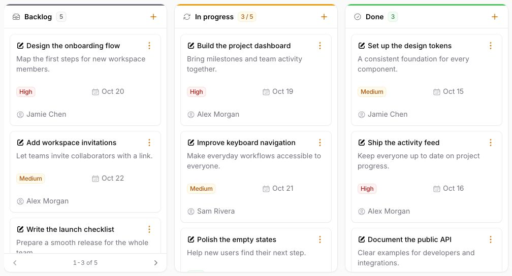

#### Flat

The Flat layout gives columns a continuous list appearance, similar to native Filament tables. Adjacent Flat cards share subtle dividers, and hovering or focusing a row highlights its background.

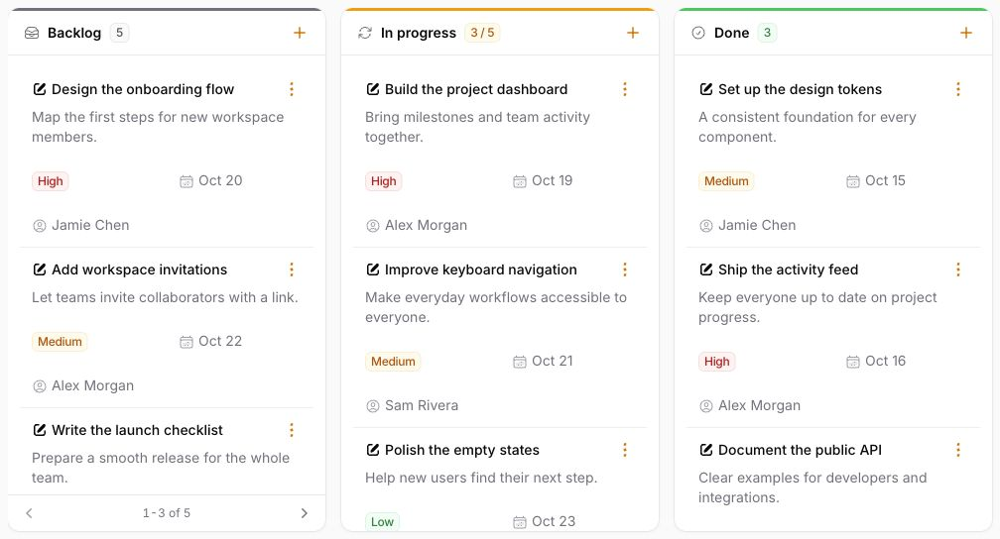

#### Accent

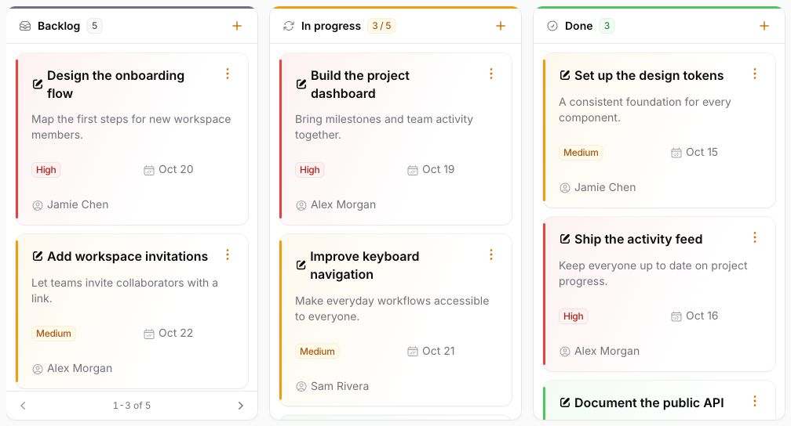

All layouts support the same schema, actions, and drag behavior. Action placement is controlled by `compactCardActions()`, independently of the selected layout.

The package follows your panel's light and dark theme:

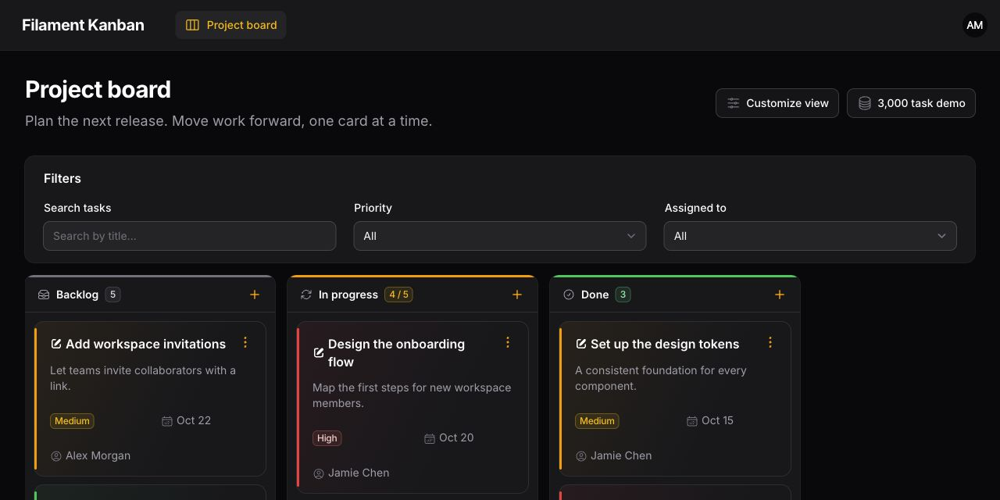

`CardView` implements Filament's `HasLabel` contract, so it can also populate a field with `->options(CardView::class)`. Labels are available in English and Brazilian Portuguese.

### Dynamic layouts and colors

```php
$board
    ->cardView(fn (Task $record) => $record->priority === 'high'
        ? CardView::Accent
        : CardView::Compact)
    ->cardColor(fn (Task $record) => $record->priority === 'high'
        ? 'danger'
        : 'success');
```

The Accent layout uses the column color unless `cardColor()` overrides it. Colors support Filament names, hex strings, palettes, and closures.

The closures for `cardView()`, `cardColor()`, and `compactCardActions()` can receive `$record` or `$card`, `$column`, `$board`, and `$livewire`. A `null` view selects the Default layout; a `null` color falls back to the column color.

## Actions and Forms

### Actions on cards

`cardActions()` accepts an array of native `Action` and `ActionGroup` instances, or a closure returning that array. The package registers them on its internal Filament table and binds them to each card's record.

```php
use Filament\Actions\Action;
use Filament\Actions\DeleteAction;
use Filament\Actions\EditAction;

$board->cardActions([
    EditAction::make(),
    Action::make('complete')
        ->label('Mark as done')
        ->icon('heroicon-o-check-circle')
        ->color('success')
        ->visible(fn (Task $record): bool => $record->status !== 'done')
        ->action(fn (Task $record) => $record->update(['status' => 'done'])),
    DeleteAction::make(),
]);
```

Native action forms, confirmation dialogs, visibility callbacks, and Filament authorization remain available. Configure your model policies and action authorization as you would for Filament table actions.

### Compact actions

```php
$board->compactCardActions();      // Header menu; equivalent to true.
$board->compactCardActions(false); // Footer actions; the default.
```

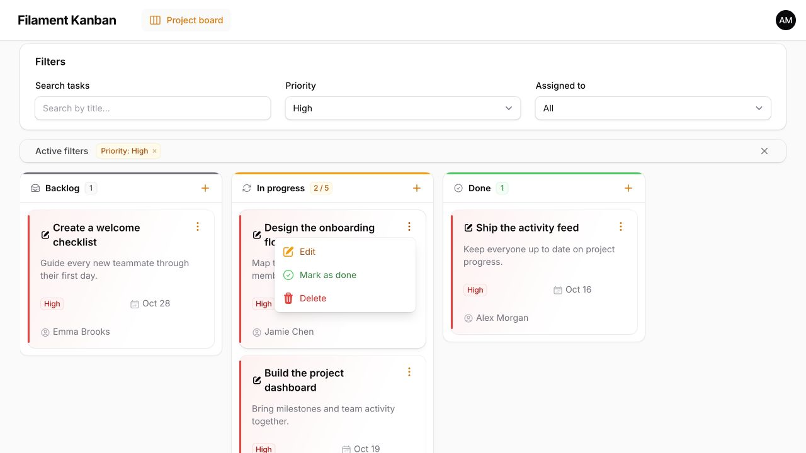

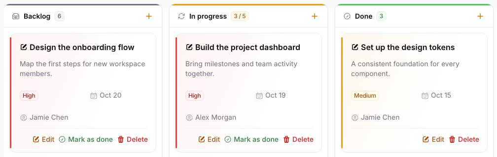

You can still supply explicit `ActionGroup` instances in either mode. Compact mode wraps the configured actions and groups in a header menu; footer mode preserves the structure you supplied.

### One shared form

Define `form()` once to share a schema between native `CreateAction`, `EditAction`, and `ViewAction` instances on cards, columns, and empty states:

```php
use Filament\Forms\Components\TextInput;
use Filament\Forms\Components\Textarea;

$board->form([
    TextInput::make('title')->required(),
    Textarea::make('description'),
]);
```

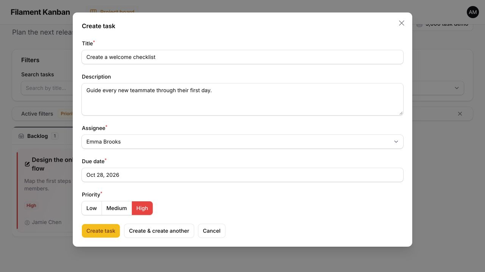

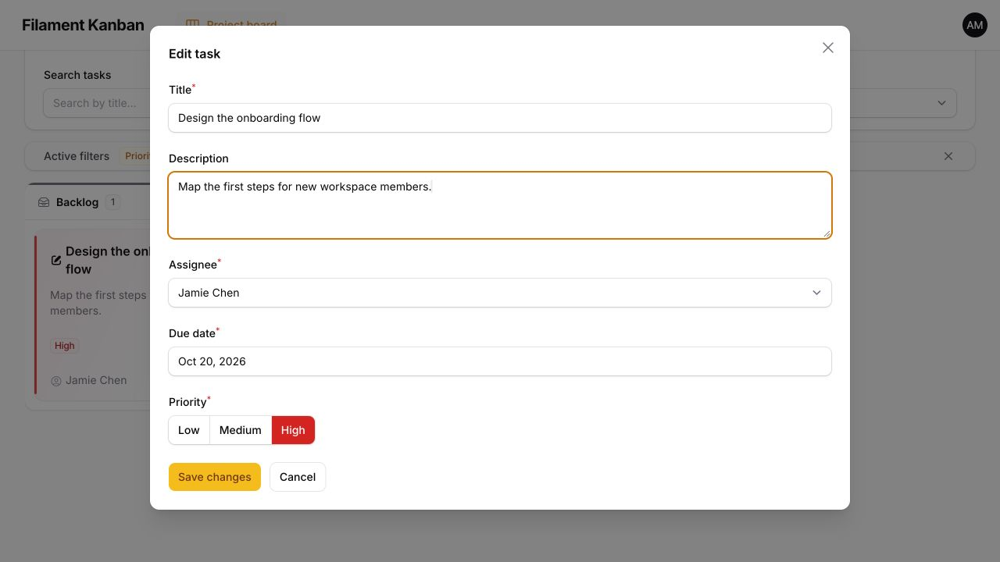

You can reuse a page method instead:

```php
use Filament\Schemas\Schema;

public function form(Schema $schema): Schema
{
    return $schema->components([
        TextInput::make('title')->required(),
        Textarea::make('description'),
    ]);
}

// Inside board():
$board->form(fn (Schema $schema): Schema => $this->form($schema));
```

The form closure is evaluated in the action's context. It can receive the native `Schema`, `$record`, `$arguments`, `$operation`, and `Board $board`.

An explicit action `schema()` takes precedence over the shared form. Use `->schema([])` to intentionally give an action no fields. Other custom actions and confirmation-only actions do not automatically receive the shared form. Nested groups are supported.

### Column actions

Add controls to each column header with `columnActions()`. The selected column is passed as `$arguments['column']`:

```php
use Filament\Actions\CreateAction;

$board->columnActions([
    CreateAction::make()
        ->model(Task::class)
        ->icon('heroicon-o-plus')
        ->iconButton()
        ->mutateDataUsing(function (array $data, array $arguments): array {
            $data['status'] = $arguments['column'];
            $data['position'] = ((int) Task::where('status', $data['status'])->max('position')) + 1;

            return $data;
        }),
]);
```

Column actions also support nested groups and the shared form. Supply application-specific values, such as a tenant or project ID, when creating records.

## Filters

Use filters from `Filament\Tables\Filters`, including `Filter`, `SelectFilter`, `TernaryFilter`, and `TrashedFilter`:

```php
use Filament\Tables\Enums\FiltersLayout;
use Filament\Tables\Filters\SelectFilter;
use Filament\Tables\Filters\TrashedFilter;

$board
    ->filters([
        SelectFilter::make('priority')
            ->options(['high' => 'High', 'medium' => 'Medium', 'low' => 'Low']),
        SelectFilter::make('assignee')
            ->options(['Alex Morgan' => 'Alex Morgan', 'Jamie Chen' => 'Jamie Chen']),
    ], layout: FiltersLayout::AboveContent)
    ->filtersFormColumns(3)
    ->deferFilters(false);
```

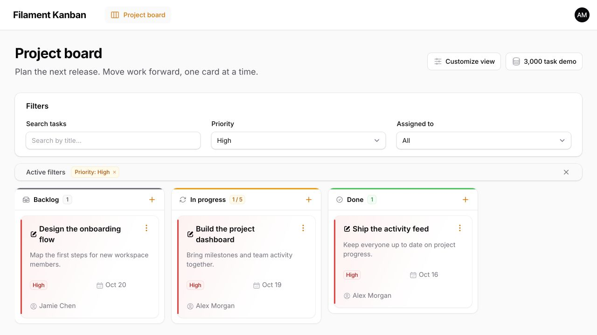

Filters use the internal Filament table, including native indicators, removable badges, reset actions, and session persistence. Eloquent filtering happens before records are distributed into columns.

Filters are **deferred by default**: users apply pending changes with the Apply filters button. Set `deferFilters(false)` to apply changes immediately.

Supported layouts include `AboveContent`, `AboveContentCollapsible`, `BelowContent`, `BeforeContent`, `BeforeContentCollapsible`, `AfterContent`, `AfterContentCollapsible`, `Dropdown`, `Modal`, and `Hidden`.

```php
$board
    ->filtersLayout(FiltersLayout::Modal)
    ->filtersFormWidth(\Filament\Support\Enums\Width::Large)
    ->filtersFormMaxHeight('28rem')
    ->persistFiltersInSession();
```

Use `filtersFormSchema()`, `filtersTriggerAction()`, `filtersApplyAction()`, `filtersRemoveAllAction()`, and `filtersResetActionPosition()` for additional native customization.

For soft-deleted records, include `withTrashed()` in your base query, add `TrashedFilter`, and configure `RestoreAction` as needed.

## Drag and Drop

Cards are draggable across their full surface by default. Actions and other explicitly ignored controls remain interactive.

```php
$board
    ->statusColumn('status')
    ->positionColumn('position')
    ->dragHandle(false);

// Use a dedicated handle instead:
$board->dragHandle();
```

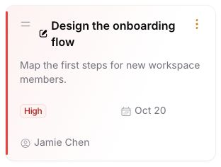

With `positionColumn()`, moving a card persists its column and order. Without it, moving persists the status, while ordering follows the base query. Filtered-out and unloaded cards are retained when reordering.

### Put incoming cards at the top

Enable `moveCardsToTop()` to always place a card first when it moves to a different column, regardless of where it was dropped:

```php
$board
    ->positionColumn('position')
    ->moveCardsToTop();
```

This requires `positionColumn()` so the order can be persisted. The moved card is inserted before all records in the destination column, including filtered-out records and records on other pages. The destination returns to its first page so the incoming card is visible if it matches the active filters. Other columns keep their current pages.

Reordering within the same column still follows the drop position. The option is disabled by default; use `moveCardsToTop(false)` to restore normal cross-column drop placement. It also accepts a boolean closure with `$record` (or `$card`), `$column` (the destination), `$board`, and `$livewire`.

The package uses animated sorting and respects reduced-motion preferences. Drag areas prevent accidental text selection.

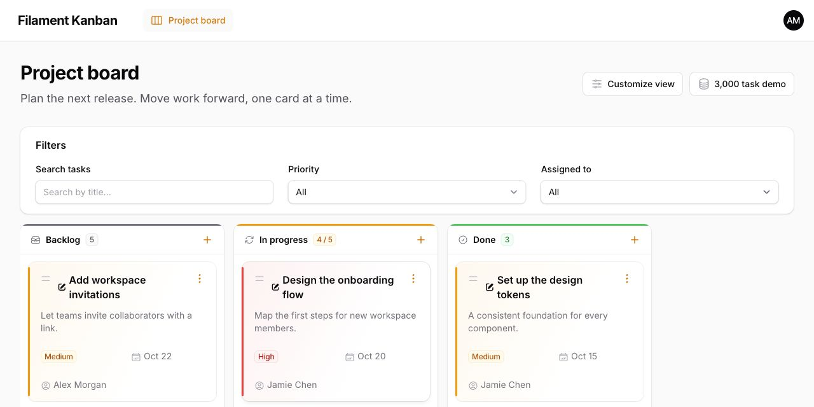

### Custom persistence

```php
use Illuminate\Support\Facades\Gate;

$board->updateStatusUsing(function (Task $record, int|string $columnId, ?int $position): void {
    Gate::authorize('update', $record);

    $record->update([
        'status' => $columnId,
        'position' => $position ?? $record->position,
    ]);
});
```

The callback handles the moved record. When a position column is configured, the package also normalizes sibling positions in the surrounding transaction. Apply record-specific move authorization in this callback when your application requires it.

After a successful move, the Livewire component dispatches `kanban-card-moved` with `card` and `column` values.

## Empty States

Each empty column uses Filament's native empty-state styling. Customize the content independently of the card layout:

```php
use Filament\Support\Icons\Heroicon;

$board
    ->emptyStateHeading('No tasks here yet')
    ->emptyStateDescription('Create a task or drop one into this column.')
    ->emptyStateIcon(Heroicon::OutlinedClipboardDocumentList);
```

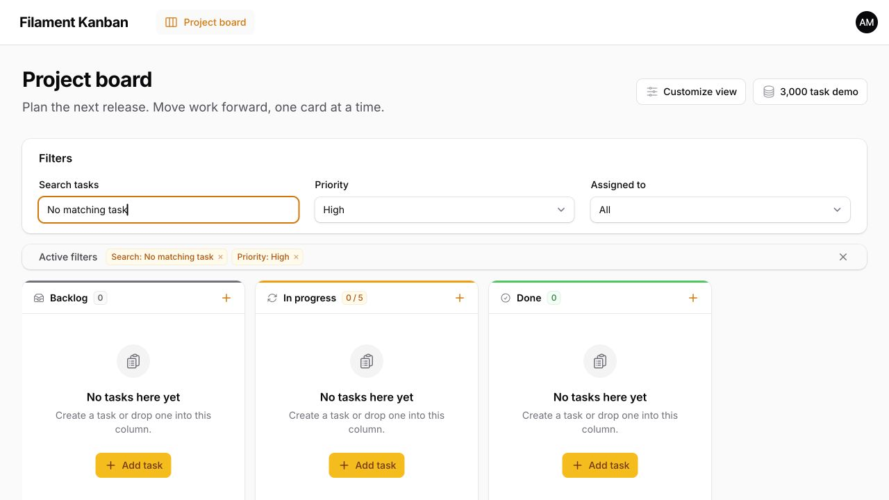

Add actions with `emptyStateActions()`. As with column actions, `$arguments['column']` identifies the target column, and `CreateAction` can use the shared form:

```php
$board->emptyStateActions([
    CreateAction::make('createEmpty')
        ->model(Task::class)
        ->label('Add task')
        ->icon('heroicon-o-plus')
        ->mutateDataUsing(function (array $data, array $arguments): array {
            $data['status'] = $arguments['column'];
            $data['position'] = ((int) Task::where('status', $data['status'])->max('position')) + 1;

            return $data;
        }),
]);
```

Headings, descriptions, icons, and custom empty-state content accept closures with `$column`, `$board`, and `$livewire`. `emptyStateIcon(null)` removes the icon. For complete control, return a view:

```php
$board->emptyState(fn (BoardColumn $column) => view('kanban.empty-state', [
    'column' => $column,
]));
```

`emptyStateActions()` accepts an array, an `ActionGroup`, or a closure returning either. Actions retain their native visibility and authorization behavior.

## Large Boards and Pagination

The board loads **50 cards per column by default**, using independent SQL pagination for each column. You can change the page size:

```php
$board
    ->query(fn () => Task::query()->with('owner'))
    ->cardsPerPage(25);
```

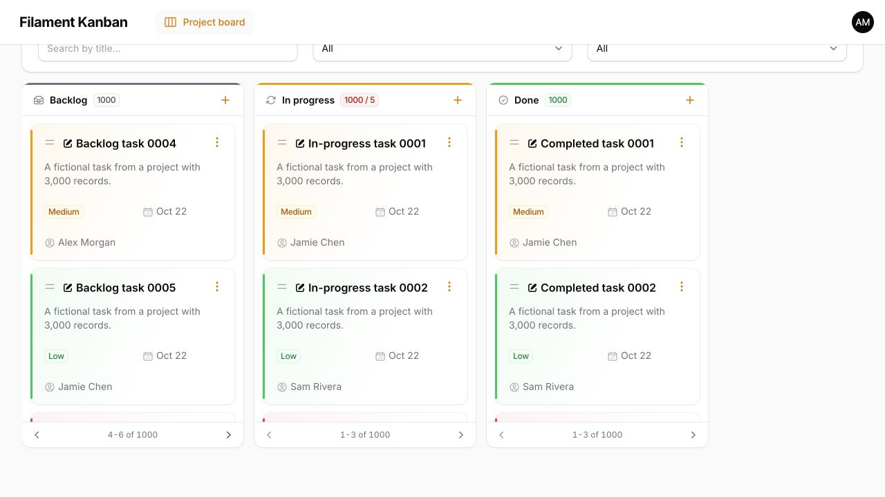

- Only the visible page of each column is hydrated and rendered.
- Counts, WIP badges, and `BoardColumn::getSum()` include the full filtered column.
- Each column has its own previous and next controls.
- Applying or resetting filters returns all columns to their first page.
- Moving cards on later pages accounts for the destination page offset.

### Progressive loading

Enable automatic loading as the user scrolls down each column:

```php
$board
    ->cardsPerPage(25)
    ->infiniteScroll();
```

`cardsPerPage()` sets the batch size. Each column initially loads one batch and keeps the previous cards visible as more batches are loaded. A native Livewire [`wire:intersect.once`](https://livewire.laravel.com/docs/4.x/wire-intersect) sentinel triggers the next batch, with a **Load more** button as a keyboard-accessible fallback.

- Columns load independently; scrolling one does not expand the others.
- Counts, sums, and WIP limits still use the complete filtered column.
- Applying or resetting filters returns every column to its first batch.
- Dragging uses positions within the full loaded list. A card dropped after the last loaded card stays visible, and `moveCardsToTop()` keeps already loaded batches when prepending a card.
- `getPaginator()` returns `null` in this mode.

The option is disabled by default and accepts a boolean or a closure with `$column`, `$board`, and `$livewire`:

```php
$board->infiniteScroll(fn (BoardColumn $column): bool => $column->getId() === 'backlog');
$board->infiniteScroll(false); // Return to numbered pages.
```

Progressive loading retains the loaded cards in the DOM and refreshes the loaded prefix on subsequent renders. It is not virtualization; use numbered pages when you need a fixed number of rendered cards throughout a long session.

If you published the column view, include `filament-kanban::column-load-more` after the card loop, inside the sortable `<ul>`. The package's sentinel is excluded from dragging.

### Batch size and query performance

Set a page or batch size from **1 to 500**, or use `null` to load all cards:

```php
$board->cardsPerPage(fn (BoardColumn $column): int => $column->getId() === 'backlog' ? 25 : 10);
$board->cardsPerPage(null); // Load every matching card; use for small boards.
```

For large Eloquent boards, use `query()` and eager-load only the relationships needed by cards. Index the status and ordering columns; include tenant/project fields when your query scopes by them:

```php
$table->index(['project_id', 'status', 'position', 'id']);
```

Reordering updates sibling positions in batches. It still reads and locks sibling IDs in the destination column; neither loading mode provides DOM virtualization or constant-time reordering.

`records(fn () => $collection)` supports collections of Eloquent models, but those records are already loaded in memory. Its callback can receive `$filters` and must apply filters to its own source. Prefer an Eloquent query for thousands of records and for persisted drag and drop.

`BoardColumn::modifyCardsUsing()` receives a complete column collection and disables that column's pagination to preserve the callback's semantics. Avoid it for large columns; express filtering and sorting in the database query instead.

## Customization

### Use your own card view

```php
$board->cardView('kanban.cards.task');
```

The view receives `$card`, `$column`, and `$board`. Keep the sortable wrapper when replacing the entire card:

```blade
<li wire:key="board-card-{{ $card->getKey() }}" wire:sort:item="{{ $card->getKey() }}">
    {{ $board->getCardSchema($card) }}
</li>
```

Custom views own their markup, action rendering, and drag styling. To retain the package's defaults while changing the card content, publish only the card view:

```bash
php artisan vendor:publish --tag=filament-kanban-card-view
```

Edit `resources/views/vendor/filament-kanban/card.blade.php`. The presets reuse this view and pass `$cardVariant` as `default`, `compact`, `flat`, or `accent`; no column override is needed.

Other publishing options:

```bash
php artisan vendor:publish --tag=filament-kanban-empty-state-view
php artisan vendor:publish --tag=filament-kanban-views
```

Published views are application overrides. Review them after package updates to incorporate new markup or behavior.

### Column totals

Inside a custom column view, use the column methods for full filtered totals, rather than counting or summing the current page:

```blade
{{ $column->getCardsCount() }}
{{ number_format($column->getSum('amount'), 2) }}

@include('filament-kanban::column-pagination', ['column' => $column])
```

### Package CSS development

Consumers receive the compiled CSS. Package contributors can rebuild it with:

```bash
npm ci
npm run build
```

Vite compiles `resources/css/filament-kanban.css` into `dist/filament-kanban.css`, including the package's Tailwind utilities. After rebuilding, run `php artisan filament:assets` in the consuming application. The package stylesheet does not include Tailwind preflight or replace your panel's theme.

## API Reference

| Board method | Purpose | Default |
| --- | --- | --- |
| `query(Builder\|Closure)` | Base Eloquent query with your access scopes. | Required for database-backed boards. |
| `records(Closure)` | Alternative collection of Eloquent models. | None. |
| `columns(array\|Closure)` | Board columns. | Empty array. |
| `statusColumn(string\|Closure)` | Model attribute that identifies the column. | `status` |
| `positionColumn(string\|Closure\|null)` | Attribute used to persist ordering. | `null` |
| `recordTitleAttribute(string\|Closure\|null)` | Separate card title attribute. | `null` |
| `cardSchema(array\|Closure)` | Native schema components for card content. | Empty content. |
| `cardView(CardView\|string\|Closure\|null)` | Built-in layout or custom view. | `CardView::Default` |
| `cardColor(string\|array\|Closure\|null)` | Accent layout color. | Column color. |
| `cardActions(array\|Closure)` | Record actions and explicit groups. | Empty array. |
| `cardAction(string\|Closure\|null)` | Action opened by the card title. | `null` |
| `compactCardActions(bool\|Closure)` | Group actions in a header menu. | `false` |
| `columnActions(array\|Closure)` | Actions in each column header. | Empty array. |
| `form(array\|Closure\|null)` | Default create/edit/view schema. | `null` |
| `filters(array\|Closure, layout: ...)` | Native Filament table filters. | Above content. |
| `deferFilters(bool\|Closure)` | Require applying pending filter changes. | `true` |
| `dragHandle(bool\|Closure)` | Use a dedicated drag handle. | `false` |
| `moveCardsToTop(bool\|Closure)` | Prepend cards when moving to a different column; requires a position column. | `false` |
| `cardsPerPage(int\|Closure\|null)` | Column page or progressive batch size. | `50` |
| `infiniteScroll(bool\|Closure)` | Load more cards automatically as each column scrolls. | `false` |
| `updateStatusUsing(Closure)` | Customize persistence for the moved card. | Update status and position. |
| `emptyStateHeading(...)` | Empty-column heading. | Native table heading. |
| `emptyStateDescription(...)` | Empty-column description. | `null` |
| `emptyStateIcon(...)` | Empty-column icon. | `Heroicon::XMark` |
| `emptyStateActions(...)` | Actions in each empty column. | Empty array. |
| `emptyState(...)` | Custom empty-state view or HTML. | Built-in view. |

| Column method | Purpose |
| --- | --- |
| `BoardColumn::make(int\|string)` | Create a column with a matching status value. |
| `label(...)`, `color(...)`, `icon(...)` | Configure the column header. |
| `limit(int\|Closure\|null)` | Set a visual WIP threshold. |
| `getCards()` | Get the current page or all progressively loaded cards. |
| `getCardsCount()` | Count all records in the filtered column. |
| `getSum(string)` | Sum an attribute across the filtered column. |
| `getPaginator()` | Get the column's paginator, or `null` for progressive/unbounded loading. |
| `hasInfiniteScroll()`, `hasMoreCards()` | Check progressive loading and whether more cards remain. |
| `modifyCardsUsing(Closure)` | Transform the full column collection and bypass its pagination. |

## Demo and Screenshots

The [standalone demo](docs/demo/README.md) uses an isolated SQLite database, 11 seeded launch tasks, a separate 3,000-task dataset, and Filament's default theme in English. It includes controls for changing layouts, action compaction, drag handles, and progressive loading.

No application theme, production records, or external images are needed to reproduce the screenshots. See [the screenshot notes](docs/SCREENSHOTS.md) for the states shown in each image.

## Testing

Run the package's standalone test suite with PHP 8.4+:

```bash
composer install
composer test
```

The tests use Orchestra Testbench, an in-memory SQLite database, and a dedicated Filament panel. No consuming application or production database is required. GitHub Actions checks PHP 8.4 and 8.5 and verifies that the committed CSS matches a fresh build.

Maintainers can find the release and plugin directory steps in [the publishing guide](docs/PUBLISHING.md).

## License

Released under the [MIT license](LICENSE.md).

## Credits

- Built for [Filament](https://filamentphp.com) and [Livewire](https://livewire.laravel.com).
- Created by [Eduardo Ribeiro](https://github.com/eduardoribeirodev).

## Support

For issues, questions, or contributions, please visit the [GitHub repository](https://github.com/eduardoribeirodev/filament-kanban). Don't forget, Jesus loves you ❤️.
